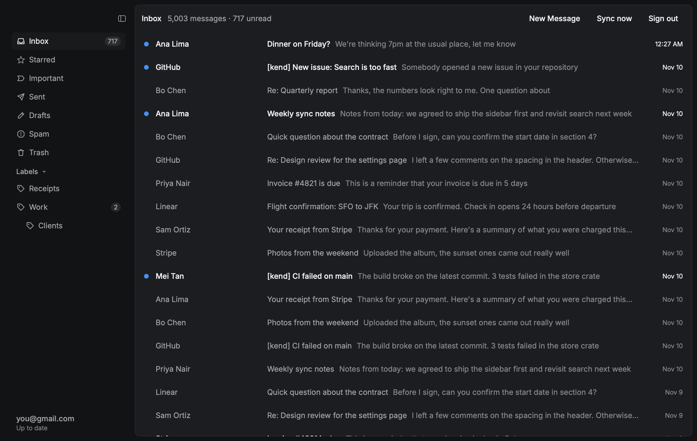
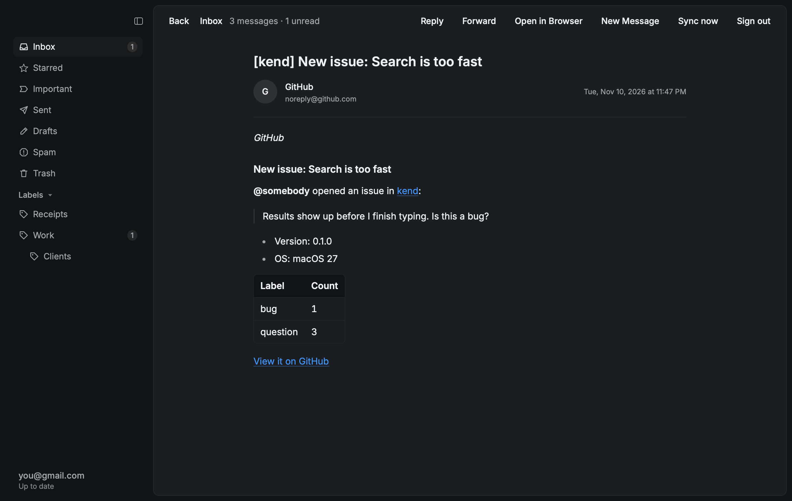
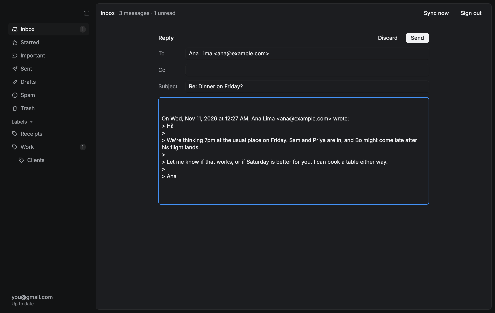

# kend

A fast, local-first Gmail client for macOS, written in Rust.

Mail syncs into a local SQLite database in the background, and the UI reads only from that
database. The inbox opens instantly, scrolling stays smooth through 100,000 messages, and
everything you've already loaded works offline. The UI is native and GPU-rendered with
[Rune](https://github.com/anomalyco/rune), not a web view.



| Reading a formatted HTML email | Replying |
|---|---|
|  |  |

## Features

- **Sign in with Google** through your own browser. The token lives only in the macOS Keychain.
- **Background sync** of your whole inbox: the newest 500 first, then older mail in batches,
  then only what changed, using Gmail's change history.
- **Sidebar** with Gmail's mailboxes, your nested labels and unread counts.
- **Message list** that builds only the rows on screen and pages from SQLite as you scroll.
- **Reading view** that turns email HTML into clean, themed text: headings, lists, quotes,
  clickable links and data tables. Remote images and tracking pixels are held back, and
  **Open in Browser** shows the original design.
- **Compose, reply and forward**, with replies kept in their Gmail conversation.
- **Keyboard first**: J/K or arrows to move, Return to open, Esc to go back, R to reply,
  F to forward, ⌘N for a new message, ⌘Return to send.
- **Light and dark** themes that follow the system.

## Performance

All numbers were measured on Apple silicon and can be reproduced with the commands shown.

**Local store**, 100,000 messages
(`cargo run --release -p kend-store --example bench`):

| Operation | Time |
|---|---|
| Inbox page, 50 rows (first page or halfway down) | 0.05 ms |
| Full-text search, typical word | 0.1 ms |
| Full-text search, word in 40% of all mail (worst case) | 26 ms |
| Unread count | 4.7 ms |
| Saving synced messages | ~40,000 / s |

**Scrolling**, 5,000-message inbox, scrolled 1,000+ rows deep, frame CPU time
(`target/release/kend --scene large --script crates/kend/scripts/scroll.json --out /tmp/frames --every 1000`):

| | Before virtualization | After |
|---|---|---|
| Debug build, median / 95th percentile | 3.6 / 4.2 ms | 1.6 / 3.8 ms |
| Debug build, first frame | 108 ms | 14 ms |
| Release build, median / 95th percentile | 1.7 / 2.9 ms | 1.8 / 2.3 ms |
| Rows reachable | 100 | the whole mailbox |

These are CPU times from a headless run, so GPU and display time aren't included. The 120 Hz
frame budget is 8.3 ms.

**Converting HTML email**: a 300 KB newsletter converts to Markdown in about 20 ms, so it
happens as the message opens.

## Architecture

```
crates/
  kend         The app: Rune UI, app state, the sync worker thread
  kend-sync    Gmail → SQLite sync: first sync, backfill, change history (tested against a fake Gmail)
  kend-gmail   OAuth sign-in, the Gmail API client, MIME parsing, building outgoing mail
  kend-store   SQLite schema, migrations, paging, full-text search
```

- **The UI never waits on the network.** Sync runs on its own thread with its own database
  connection (SQLite in WAL mode). Results reach the UI as events, and the UI then re-reads
  the database.
- **Gmail's quota is shared.** One API client serves sync and the UI. A pacer spaces requests
  to stay under Gmail's per-user quota, and when Gmail says slow down, every thread backs off
  together.
- **Sync is resumable.** An interrupted first sync picks up where it stopped, keeping its
  original starting point, so changes made in between are still replayed. Older mail loads
  from a saved position, so an old message moved into the inbox can't make sync skip mail.
- **Inbox pages are a single index lookup.** Pages are keyed by position, not offset, over a
  covering index, so page 1,000 costs the same as page 1.
- **Full-text search** uses SQLite FTS5, kept in sync with the messages by triggers. Subject
  and sender rank above body text.

### How sign-in works

Sign-in follows [RFC 8252](https://datatracker.ietf.org/doc/html/rfc8252), OAuth for native apps:

- The system browser handles Google sign-in, so kend never sees your password.
- Google redirects to a one-shot listener on `127.0.0.1`, on a random port.
- PKCE and a `state` check protect the authorization code.
- The refresh token is stored only in the macOS Keychain. Access tokens stay in memory.
- kend asks for a single scope, `gmail.modify`: read, label and send, with no permanent deletion.

### Safety

- Links in email open only if they're `http`, `https` or `mailto`.
- Line breaks are stripped from header fields in outgoing mail, so typed text can't add
  headers (header injection).
- Remote images aren't loaded, so opening an email doesn't tell the sender.
- Signing out deletes the account's local mail and revokes its token.

## Setup

kend signs in with a Google OAuth client of type "Desktop app":

1. Create a Google Cloud project and enable the Gmail API.
2. Create an OAuth client (Desktop app) at https://console.cloud.google.com/auth/clients.
3. Copy `.env.example` to `.env` and fill in the client ID and secret.

These values are built into the app at compile time, and `.env` is ignored by git.

## Build, run and test

Requires Rust. The version is pinned in `rust-toolchain.toml`.

```sh
cargo run -p kend                      # open the app
cargo test                             # 98 tests across the workspace
cargo run --release -p kend-store --example bench

# Render a screen without a window, from built-in sample data (no account needed)
target/release/kend --scene reading-html --snap reading.png
```

Debug builds compile dependencies with optimizations (`[profile.dev.package."*"]`), so
`cargo run` stays smooth while kend's own code still builds quickly.

## Roadmap

- Prefetch bodies for the newest mail, so even the first open is instant
- Reply All, drafts and attachments
- Optional image loading
- Sync Sent, Starred and other mailboxes beyond the inbox
- Fuzzy ⌘K quick-jump with frecency ranking
